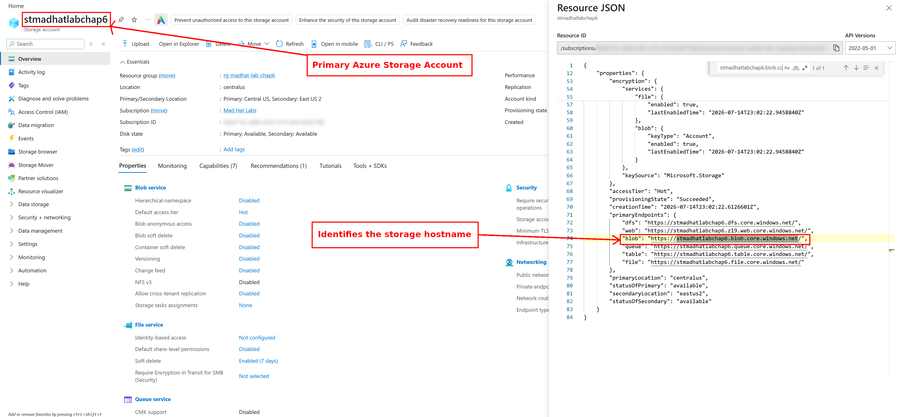
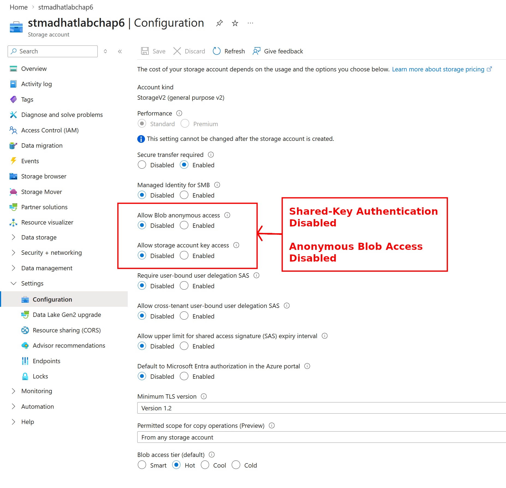
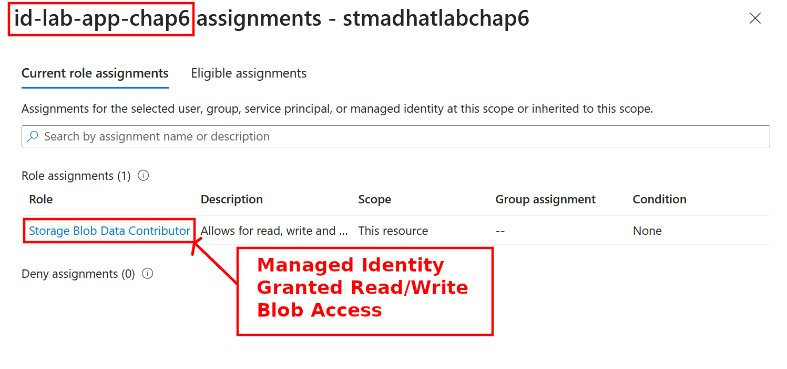
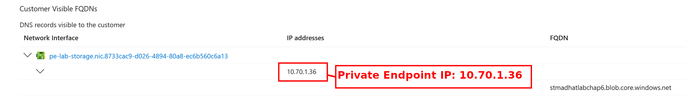
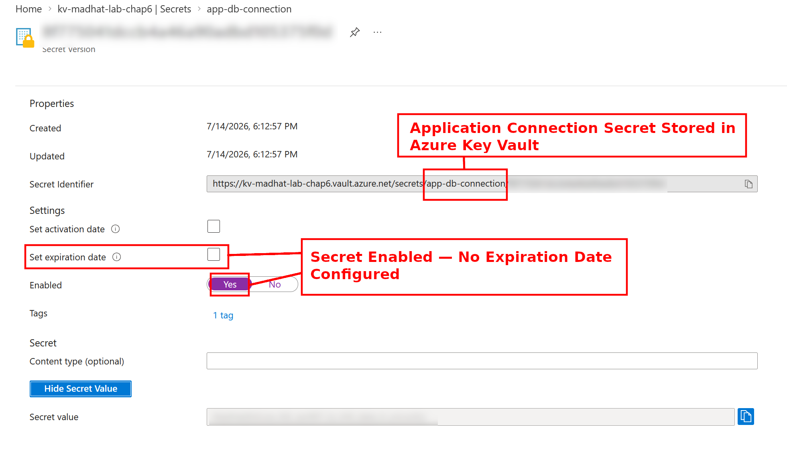
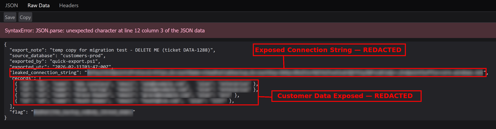

# Azure Storage Security Investigation — Exposed Backup Data

## Environment

- **Platform:** Microsoft Azure
- **Lab:** Mad Hat Labs — Azure Fundamentals
- **Tools:** Azure Portal, Firefox
- **Services:** Azure Blob Storage, Managed Identities, RBAC, Private Endpoints, Azure Key Vault
  

## Objective

Investigate how an Azure application accesses storage securely and identify potential data exposure.

## Investigation

### 1. The Data — Storage Account

- Located the primary Azure Storage account.
- Examined the resource JSON to identify the Blob service endpoint.
- Established the starting point for investigating data access.

### 2. The Key Posture — Authentication

- Confirmed shared-key authentication was disabled.
- Verified anonymous Blob access was disabled.
- Identified identity-based authentication as the intended access method.

- Examined the application's managed identity.
- Confirmed the Storage Blob Data Contributor role.
- Verified the identity had read/write permissions at the storage resource scope.

### 3. The Network — Private Endpoint

- Inspected the private endpoint's DNS configuration.
- Identified the private IP address `10.70.1.36`.
- Confirmed the Blob hostname was associated with the private endpoint.

### 4. The Secrets — Azure Key Vault

- Located the application's connection secret in Azure Key Vault.
- Confirmed the secret was enabled.
- Identified that no expiration date was configured.

### 5. The Loot — Exposed Backup

- Discovered a separate backup storage account.
- Accessed a publicly available JSON export without authentication.
- Identified exposed customer records and a storage connection string.
- Redacted sensitive information and training flags before documentation.

## Key Findings

**Positive Security Controls**
- Shared-key authentication disabled.
- Anonymous access disabled on primary storage.
- Managed identity with RBAC permissions.
- Private endpoint configured for storage access.

**Security Risks**
- Separate backup storage exposed data publicly.
- Export contained customer information and a connection string.
- Key Vault secret had no expiration date.

## Recommendations

1. Disable anonymous access to the exposed backup container.
2. Remove exposed data and rotate the compromised storage account key.
3. Review backup storage permissions and network restrictions.
4. Configure secret expiration and rotation policies.
5. Audit all storage accounts, including temporary backups.

## Conclusion

The primary storage account used multiple security controls, but a separate backup exposed sensitive data.

**Key Lesson:** Securing production storage does not automatically protect backup copies.

*Investigation performed in an authorized Azure training environment. Sensitive information and challenge answers have been redacted.*
