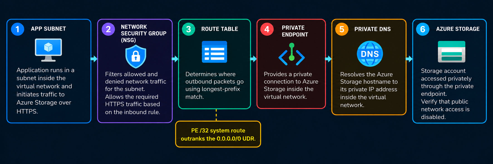
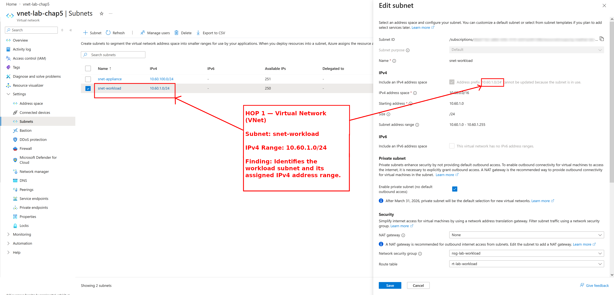
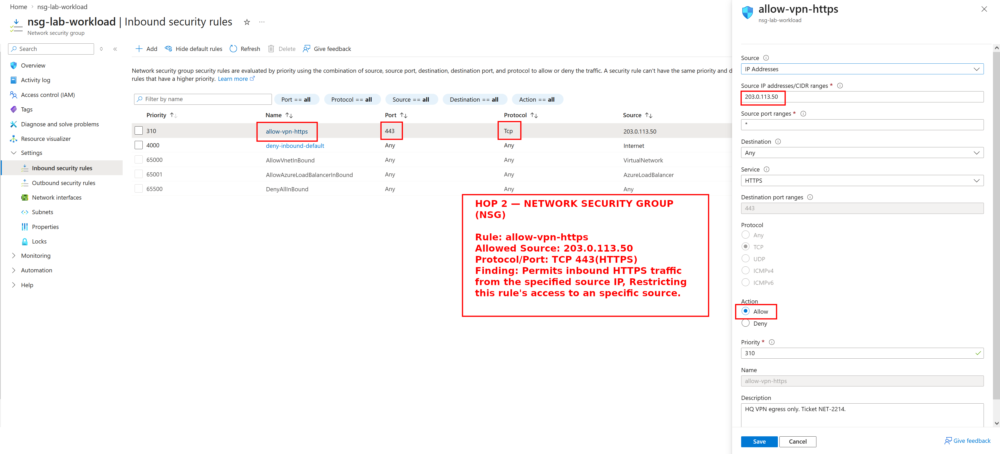
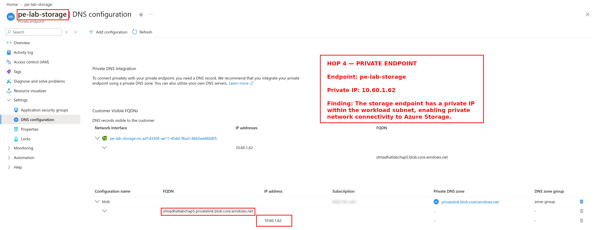
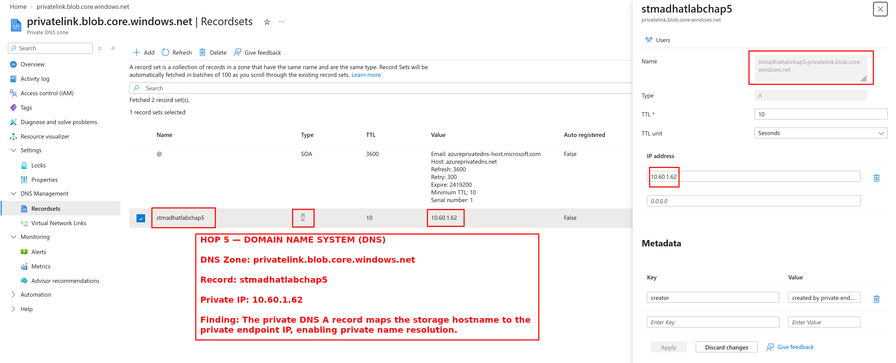

# Week 5 — Network Like an Op

## Objective
Investigate how an application workload communicates with Azure Storage through a private endpoint. Review the virtual network, security rules, routing, private endpoint, and DNS configuration to understand the network path.

## Environment

- **Platform:** Microsoft Azure
- **Environment:** Live multi-user Azure training tenant
- **Access Level:** Reader access
- **Tools:** Azure Portal
- **Services Investigated:**
  - Azure Virtual Network (VNet)
  - Network Security Groups (NSGs)
  - User-Defined Routes (UDRs)
  - Azure Private Endpoint
  - Azure Private DNS (Domain Name System)
  - Azure Storage

## The Ticket

The application team wants to understand how its workload can reach Azure Storage privately and why traffic may bypass the firewall despite a forced-egress route.

## Network Path Diagram

## Network Trace

### Hop 1 — Virtual Network (VNet)

**Checked:** `vnet-lab-chap5` → Subnets → `snet-workload`

**Found:** The workload subnet uses `10.60.1.0/24`.

**What it means:** The application operates within this subnet. Its address range identifies the network where the workload originates.

### Hop 2 — Network Security Group (NSG)

**Checked:** `nsg-lab-workload` → Inbound security rules

**Found:** The `allow-vpn-https` rule permits inbound HTTPS (Hypertext Transfer Protocol Secure) traffic from `203.0.113.50`.

**What it means:** The rule allows a specific source address to connect using HTTPS rather than allowing unrestricted inbound access. This is an inbound rule; outbound access to Storage must be evaluated separately.

### Hop 3 — Route Table

**Checked:** `rt-lab-workload` → Routes → `force-egress`

**Found:** The route points to next-hop IP (Internet Protocol) address `10.60.100.4`.

**What it means:** The route directs matching outbound traffic toward a network appliance for inspection. However, Azure selects routes using longest-prefix matching, so a more specific route can take precedence.

### Hop 4 — Private Endpoint

**Checked:** `pe-lab-storage` → DNS configuration

**Found:** The private endpoint uses IP address `10.60.1.62`.

**What it means:** Azure Storage can be accessed through a private IP inside the virtual network rather than through its public endpoint.

### Hop 5 — Domain Name System (DNS)

**Checked:** `privatelink.blob.core.windows.net` → A record

**Found:** `stmadhatlabchap5.privatelink.blob.core.windows.net`

**What it means:** The private DNS zone maps the Storage service's hostname to its private endpoint IP, allowing applications to use a hostname instead of hardcoding an address.

## Answer to the Application Team

The application runs in snet-workload (10.60.1.0/24) within vnet-lab-chap5. The Network Security Group (NSG) controls permitted traffic, while the route table directs outbound traffic toward the virtual appliance at 10.60.100.4.

Azure Storage is accessed through the private endpoint at 10.60.1.62, and Private DNS resolves the storage hostname to that private IP address. Azure's more specific /32 private endpoint system route takes precedence over the general 0.0.0.0/0 forced-egress route. This explains why storage traffic can bypass the firewall while remaining within the private network path.

## Security Observations

The application runs in snet-workload (10.60.1.0/24) within vnet-lab-chap5. The Network Security Group (NSG) controls permitted traffic, while the route table directs outbound traffic toward the virtual appliance at 10.60.100.4.

Azure Storage is accessed through the private endpoint at 10.60.1.62, and Private DNS resolves the storage hostname to that private IP address. Azure's more specific /32 private endpoint system route takes precedence over the general 0.0.0.0/0 forced-egress route. This explains why storage traffic can bypass the firewall while remaining within the private network path.

## Lessons Learned

- Network Security Groups control permitted traffic.
- Route tables determine where packets are forwarded.
- More specific routes take precedence over broader routes.
- Private Endpoints provide private access to Azure services.
- DNS resolves service hostnames to private IP addresses.
